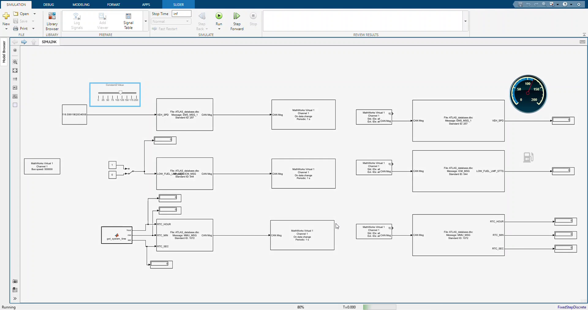
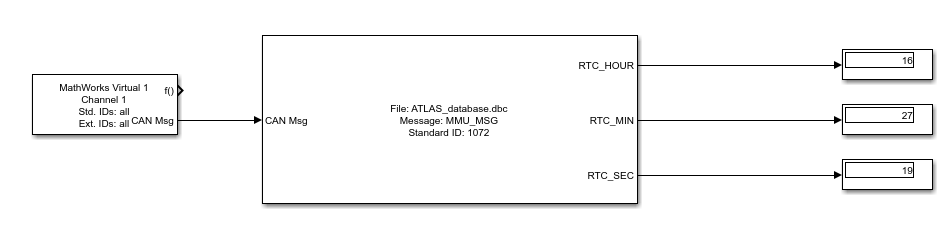

# Database-Driven CAN Communication and Dashboard Modeling in Simulink

Sana Gholipour Bashiri

## Abstract

This project models automotive CAN communication in MATLAB/Simulink using database-defined message packing, transmission, reception, and signal visualization. Two saved models provide complementary operating modes: a bidirectional model with speed, fuel, and host-clock stimuli, and a receive-oriented model for observing an external source. The native files target a Vector VN1630 interface at 125 kbit/s with a fixed-step discrete solver and a 10 ms base step. Recorded material also preserves an earlier virtual-channel demonstration. Inspection of the model archives establishes their block structure, message definitions, scheduling settings, and database dependencies. The assessment identifies differences between recorded and saved configurations, a speed-signedness inconsistency inherited from the database, and the absence of machine-readable measurement logs. The repository provides portable database paths and clear reproduction steps without asserting unperformed timing or hardware validation.

## 1. Introduction

A CAN model must connect engineering signals to the exact payload definition used on the bus. Database-driven blocks reduce duplicated bit-layout definitions, while separate transmit and receive paths expose the transformation between physical values and network messages. The model can then be used either to stimulate an instrument interface or to observe messages produced by an external node.

Vehicle Network Toolbox supplies the CAN Configuration, CAN Pack, CAN Transmit, CAN Receive, and CAN Unpack blocks used here [5]. The project applies these blocks to three standard-identifier messages: vehicle speed, low-fuel status, and time of day. Dashboard elements and numeric displays provide immediate visual feedback, and a MATLAB Function supplies computer-clock fields. The two model files are retained as separate entry points within this standalone repository.

## 1.1 Assessment method

The analysis uses the SLX model archives, their saved parameters and embedded function, the bundled DBC, selected screenshots, and an existing demonstration video. The model metadata records MATLAB R2024b. No new execution using that model version and a configured CAN device was performed for this report. Results are therefore presented as inspected configuration properties, calculated encoding examples, and explicitly identified recorded observations. No numerical claims about jitter, loss, latency, or hardware accuracy are inferred from a dashboard display alone.

## 2. Model architecture

SIMULINK.slx contains three CAN Pack blocks, three CAN Transmit blocks, three CAN Receive blocks, and three CAN Unpack blocks. Its speed source is a Constant block controlled by a dashboard slider. A Manual Switch selects the fuel-state input. A MATLAB Function produces hour, minute, and second values for the time message. Receive paths feed numeric displays, a circular speed gauge, and a fuel lamp.

CANoe_and_simulink.slx contains the receive side: a CAN Configuration block, three CAN Receive blocks, three CAN Unpack blocks, and dashboard/display elements. It does not contain the transmit or clock-generation blocks of the bidirectional model. Despite its filename, it can be understood as a receive-oriented CAN observer; the repository includes its own database and does not require another project directory.

Table 1. Saved native-model settings.

| Property | SIMULINK | CANoe_and_simulink |
|---|---|---|
| Saved release | R2024b | R2024b |
| Device | Vector VN1630 1, channel 1 | Vector VN1630 1, channel 1 |
| Bus speed | 125,000 bit/s | 125,000 bit/s |
| Receive sample time | 0.01 s | 0.01 s |
| Solver / fixed step | FixedStepDiscrete / 0.01 s | FixedStepDiscrete / 0.01 s |
| Stop time | inf | inf |
| Pack / transmit blocks | 3 / 3 | 0 / 0 |
| Receive / unpack blocks | 3 / 3 | 3 / 3 |

Figure 1. Stimulus / host clock -> CAN Pack / transmit -> CAN Receive / unpack -> Dashboard / displays

Figure 1. Functional flow of the bidirectional model. The receive-oriented model begins at the receive/unpack stage and obtains frames from the selected CAN channel.

## 2.1 Database portability

The original models referred to a DBC in an absolute directory on another computer. In the packaged copies, those paths are replaced with ATLAS_database.dbc, stored beside the models. The helper open_project.m adds that directory to the MATLAB path and resolves database-block references to the local file. This packaging edit preserves block connections, signal types, stimulus values, and device selection. It opens the model without starting a simulation or generating traffic.

## 3. Message encoding and source generation

All three messages use eight-byte payloads and standard identifiers. Table 2 lists the signal map. CAN Pack accepts engineering values and encodes them using the DBC scale, offset, bit position and type. CAN Unpack applies the corresponding decoding. This makes the DBC the central semantic dependency, so inconsistent signal metadata affects both directions rather than being confined to a single block [1, 5, 6].

Table 2. Database signal interface.

| Message / ID | Signals | Encoding |
|---|---|---|
| EMS_MSG_1 / 0x101 | VEH_SPD | Start 0; 12 bits; factor 0.125; little-endian |
| ICM_MSG / 0x220 | LOW_FUEL_LMP_STTS | Start 6; 2 bits; factor 1; little-endian |
| MMU_MSG / 0x430 | RTC_SEC, RTC_MIN, RTC_HOUR | Starts 0, 8, 16; lengths 8, 8, 6; factor 1 |

## 3.1 Speed and fuel stimuli

The speed slider changes the Constant2 block value. The saved value is approximately 53.4413, while the packed signal has a 0.125 km/h quantum. That saved scalar describes an input setting, not a measured vehicle speed. A non-grid input should be checked against the actual packing behavior before a precise received value is reported. The fuel switch selects constants representing the normal and low-fuel states. The two-bit database definition also allows blinking and reserve, but the supplied switch does not independently expose all four codes.

## 3.2 Host-clock function

The embedded function reads c = clock and returns uint8(c(4)), uint8(c(5)), and uint8(floor(c(6))) as hour, minute, and second. Its output order is hour, minute, second, matching the named input ports of the time-message packer. The payload byte order is different because the DBC assigns seconds to byte 0, minutes to byte 1, and hours to the lower six bits of byte 2. For 14:35:40, the expected data field is:

```text
28 23 0E 00 00 00 00 00
```

Reading computer time inside a simulation does not synchronize wall-clock time with simulation time. The relationship depends on scheduling and pacing. A 10 ms solver step alone does not prove 10 ms wall-clock execution. The host-clock function should be assessed in the intended simulation mode before applying deployment or code-generation assumptions.

## 4. Recorded model observations

The existing video shows a bidirectional layout with speed, fuel and clock transmit chains alongside corresponding receive chains. It records a MathWorks Virtual 1 channel at 500,000 bit/s, whereas the saved SLX files inspected here select Vector VN1630 channel 1 at 125,000 bit/s. The screenshot below therefore documents a recorded virtual-channel configuration, not the current saved hardware configuration.



Figure 2. Frame sampled at 5 s from the supplied demonstration video; virtual-channel settings differ from the packaged native models.

The recording supports the presence of the dashboard slider, message packers, transmitter paths, numeric displays, and speed gauge in that session. A visible gauge or zero-valued display alone does not establish that a corresponding bus message was received successfully at that instant. No time-aligned raw capture accompanies the video, so it cannot support loss-rate or latency calculations.



Figure 3. Recorded clock receive/unpack path with separate hour, minute, and second outputs.

## 4.1 Evidence interpretation

The figures directory retains selected transmit and receive chain screenshots and a receive-dashboard overview. These images describe model organization and historical displayed states. The native-model parameter summary in Table 1 takes precedence when reproducing the packaged files. Keeping those evidence types distinct prevents an earlier virtual demonstration from being cited as proof of a later physical-interface test.

## 5. Scheduling, numerical interpretation, and limitations

The DBC defines message periods of 100 ms for speed and fuel and 1000 ms for time. The saved transmit blocks, however, enable periodic transmission with MessagePeriod = 1.000 s for all three messages; their data-change trigger is also enabled. The model therefore does not simply inherit all message periods from the database. Changing the slider can generate additional transmissions, while an unchanged value is refreshed according to the configured one-second period. Actual timing must be checked in a bus log under the selected runtime.

Table 3. Distinct timing quantities.

| Quantity | Saved value / meaning |
|---|---|
| Base solver step | 0.01 s; simulation-time increment |
| CAN Receive sample time | 0.01 s; block reception service setting |
| Periodic CAN Transmit | 1.000 s in each transmit block |
| Data-change trigger | Enabled; may add transmissions when input changes |
| DBC cycle metadata | 100 / 100 / 1000 ms; differs from two transmit periods |

## 5.1 Speed signedness

VEH_SPD is declared signed with a 12-bit field and 0.125 scale, but the DBC states a positive maximum of 511.625 km/h. A signed 12-bit field has a positive maximum of 2047, corresponding to 255.875 km/h. Raw 0x800 decodes to -256 km/h under signed interpretation, and the reserved 0xFFE code numerically becomes -0.25 km/h. The saved slider operates within a 0-200 region, which does not expose this boundary. Both models preserve the original signal type; no silent conversion to unsigned has been applied.

The clock values fall within the positive ranges of their signed fields, but their DBC min/max metadata are zero. Range validation should therefore be reviewed together with signedness. A robust interface should define the valid physical ranges, fault codes, and out-of-range behavior consistently in the database and in every consuming block.

## 5.2 Channel and measurement boundaries

A MathWorks virtual channel and a physical Vector interface are different operating environments. Pacing, driver installation, device discovery, and channel selection affect execution and observation. For an external-source session, confirm that all blocks refer to the same intended hardware channel and that only the desired node owns each transmitted identifier. Raw BLF, ASC, MDF, or exported time-series results were not supplied, and the generated slprj cache is not treated as a measurement dataset.

Calculated payload vectors accompany the repository to make bit layouts auditable. They verify arithmetic examples and static saved parameters; they do not validate native block execution, driver compatibility, electrical wiring, or real-time scheduling. A fresh logged run is required before assigning quantitative performance claims.

## 6. Reproduction procedure

Use MATLAB/Simulink with Vehicle Network Toolbox and a release compatible with the R2024b model files. For physical operation, provide the Vector driver/interface required by the saved channel selection. Open the simulation directory and call open_project for the bidirectional model, or open_project('CANoe_and_simulink') for the receive-oriented model. The helper resolves local database paths but leaves device and timing choices visible for review.

Before running, inspect CAN Configuration and every transmit/receive block. Retain Vector VN1630 channel 1 at 125 kbit/s only when that hardware and bus configuration match the intended setup. For virtual operation, explicitly select suitable MathWorks virtual channels and document their connection. Reconcile the speed/fuel transmit periods with the 100 ms database metadata if specification-matched timing is required. Enable pacing when comparing host-clock values with a wall-clock display, and record the pacing choice.

Begin with known inputs: 100 km/h maps to raw 800 and bytes 20 03 when unused bits are zero; fuel code 1 maps to byte 0 equal to 0x40; time 14:35:40 maps to 28 23 0E followed by zeros. Observe pack/unpack outputs and capture the actual channel traffic. Then test fractional speed, every fuel code, clock rollover, and invalid/reserved values. Save logs and observed results separately from the calculated vectors already included.

## 7. Conclusion

The project provides two inspectable CAN communication models with a shared local database and explicit dashboard connections. The saved artifacts establish a bidirectional stimulus/observation workflow and a receive-only workflow, while the recording illustrates an earlier virtual configuration. Their main interpretation constraints are the difference between saved and recorded channels, nonmatching database and transmit periods, and the signed speed definition. Documenting these properties makes the repository reproducible and establishes a clear basis for future logged validation.

## References

[1] Project database: simulation/ATLAS_database.dbc.

[2] Bidirectional native model: simulation/SIMULINK.slx; saved metadata R2024b.

[3] Receive-oriented native model: simulation/CANoe_and_simulink.slx; saved metadata R2024b.

[4] Recorded evidence: results/videos/simulink_demonstration.mp4 and results/figures/.

[5] MathWorks, Vehicle Network Toolbox Simulink Blocks. https://www.mathworks.com/help/vnt/ug/vnt-simulink-blocks.html. Accessed 24 October 2026.

[6] MathWorks, CAN Unpack (database-based signal decoding and scaling). https://www.mathworks.com/help/vnt/ug/canunpack.html. Accessed 24 October 2026.
